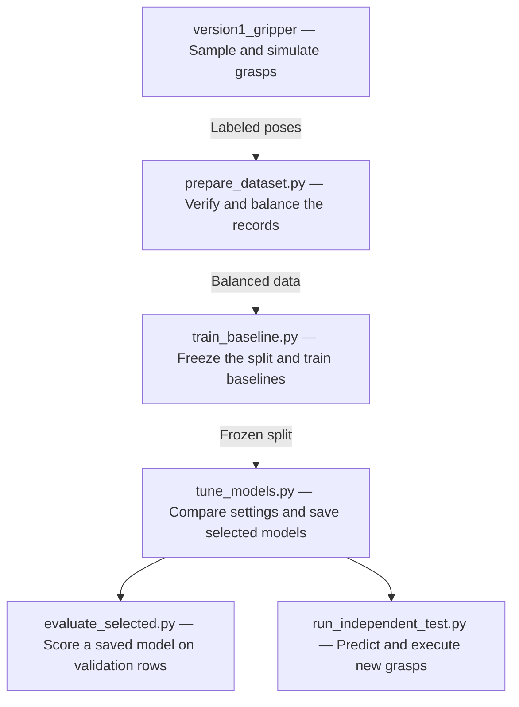

# PyBullet Gripper — demo_0

This branch runs a PR2 gripper and cube simulation from the command line.
It records the measured pose before closing the gripper and labels each
attempt from the simulated lift. Classifiers learn to predict that outcome
from the pose. The included data and models cover this one gripper/object
pair. `main.py` opens the PyQt mock interface.

**See the result first.** The [30-grasp comparison](output/independent_comparison_pr2_cube_v1_seed9002/test_predictions.csv)
shows what each saved classifier predicted and what happened in the simulator.
The [experiment report](docs/ML_EXPERIMENT_REPORT.md) explains the scores and
how to reproduce them.

## Quick start

Run these commands from the repository directory with your Python environment
active. The tested environment uses Python 3.9, PyBullet 3.2.5, NumPy 2.0.2,
pandas 2.3.1, scikit-learn 1.6.1 and joblib 1.5.1. Plotting uses Matplotlib
3.9.4 and the optional GUI uses PyQt6.

**Inspect the data used for the ML experiments.**

```bash
python inspect_dataset.py output/dev_pr2_cube_v1_balanced240/development.csv
```

Expect 240 rows, six pose features, and 120 samples per class. Label `0`
means failure and `1` means success.

**Run a small simulation.** This collects five valid attempts and writes
`grasps.csv` (poses and labels) and `attempts.csv` (including rejected
candidates) to the chosen directory. Pick a fresh directory for each run.
See the [simulation and pose data guide](ML_DATA_COLLECTION.md) for details.

```bash
python version1_gripper --direct --samples 5 --seed 42 --output output/quick_start_recheck
```

**Replay 10 model predictions.** This loads the saved logistic regression
model and repeats the recorded seed-9001 test. The terminal shows the predicted
and actual outcome for each grasp. Expect 10 valid attempts and 8 correct
predictions in the tested environment. Use a fresh output directory if you
repeat the command.

```bash
python run_independent_test.py --samples 10 --seed 9001 --output output/quick_prediction_recheck
```

Open `output/quick_prediction_recheck/test_predictions.csv` for each pose and
its prediction. See `test_summary.json` in the same directory for accuracy.

## First-round ML workflow

Start here if you are onboarding to the ML work. The arrows show how the
main scripts pass data and saved models through the command-line demo.



`run_independent_test.py` reuses the simulator in `version1_gripper`.
It predicts before finger closure and scores the prediction after the lift.

If your task is to **use the current results**, start with the
[balanced dataset](output/dev_pr2_cube_v1_balanced240/development.csv) and the
[comparison results](output/independent_comparison_pr2_cube_v1_seed9002/test_summary.json).
Read the training scripts when you need to retrain, check the split, or change
the model settings.

## Supporting ML files

These scripts explain or extend the first-round experiments. The raw-pose
workflow above can run without reproducing these experiments.

| File | When to open it |
| --- | --- |
| [diagnose_models.py](diagnose_models.py) | Check which poses the models misclassified. This module also provides shared experiment settings for the analysis scripts and pipeline training. |
| [plot_learning_curves.py](plot_learning_curves.py) | Check how scores changed with the number of training samples. |
| [compare_pose_features.py](compare_pose_features.py), [train_pose_pipeline.py](train_pose_pipeline.py) | Reproduce the raw-angle vs. sin/cos experiment or train a new sin/cos pipeline. The saved sin/cos model uses `encode_angles` from the comparison module at prediction time. |

## Shared checks and other team files

| File or folder | Role |
| --- | --- |
| [inspect_dataset.py](inspect_dataset.py), [artifact_paths.py](artifact_paths.py) | Shared checks for pose CSVs, experiment paths and file hashes. |
| [tests/](tests/) | Automated checks for the simulator and ML workflow. Run with `python -m unittest discover -s tests`. |
| [output/](output/) | Recorded data, saved models and experiment results. Follow the [experiment report](docs/ML_EXPERIMENT_REPORT.md) to find the files for a specific run. |
| [record_grasp_demo.py](record_grasp_demo.py) | Records simulated grasps for visual review. |
| [main.py](main.py), [login.ui](login.ui), [main_window.ui](main_window.ui) | The separate PyQt mock interface. Start here for GUI work. |
| [Coursework brief](OOP%20-%20Final%20CW%20Description2026.pdf) | The full assignment, including GUI integration and coverage beyond PR2/cube. |
