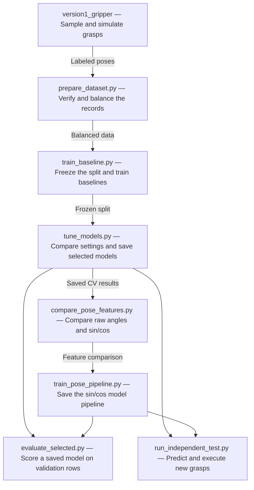

# PyBullet Gripper — demo_0

This branch runs a PR2 gripper and cube simulation from the command line.
It records the measured pose before closing the gripper and labels each
attempt from the simulated lift. Classifiers learn to predict that outcome
from the pose. The included data and models cover this one gripper/object
pair. `main.py` opens the PyQt mock interface.

**See the result first.** The [30-grasp comparison](output/independent_comparison_pr2_cube_v1_seed9002/test_predictions.csv)
shows what each saved classifier predicted and what happened in the simulator.
The [experiment report](docs/ML_EXPERIMENT_REPORT.md) explains the scores and
how to reproduce them.

## Quick start

Run these commands from the repository directory with your Python environment
active. The tested environment uses Python 3.9, PyBullet 3.2.5, NumPy 2.0.2,
pandas 2.3.1, scikit-learn 1.6.1 and joblib 1.5.1. Plotting uses Matplotlib
3.9.4 and the optional GUI uses PyQt6.

**Inspect the data used for the ML experiments.**

```bash
python inspect_dataset.py output/dev_pr2_cube_v1_balanced240/development.csv
```

Expect 240 rows, six pose features, and 120 samples per class. Label `0`
means failure and `1` means success.

**Run a small simulation.** This collects five valid attempts and writes
`grasps.csv` (poses and labels) and `attempts.csv` (including rejected
candidates) to the chosen directory. Pick a fresh directory for each run.
See the [simulation and pose data guide](ML_DATA_COLLECTION.md) for details.

```bash
python version1_gripper --direct --samples 5 --seed 42 --output output/quick_start_recheck
```

## How the files fit together

The arrows show the flow of data and saved models through the command-line demo.



`run_independent_test.py` reuses the simulator in `version1_gripper`.
It predicts before finger closure and scores the prediction after the lift.

| Supporting file | Role |
| --- | --- |
| [inspect_dataset.py](inspect_dataset.py) | Checks the pose CSV and labels before training. |
| [diagnose_models.py](diagnose_models.py) | Analyzes training errors and provides shared experiment settings for the analysis scripts and Pipeline training. |
| [plot_learning_curves.py](plot_learning_curves.py) | Shows how scores change with training set size. |
| [record_grasp_demo.py](record_grasp_demo.py) | Records simulated grasps for visual inspection. |
| [artifact_paths.py](artifact_paths.py) | Resolves experiment files and computes their verification hashes. |
| [main.py](main.py) and the `.ui` files | Run and lay out the separate PyQt mock interface. |

Run the automated checks with `python -m unittest discover -s tests`. The
[coursework brief](OOP%20-%20Final%20CW%20Description2026.pdf) describes the full assignment.

When editing pose encoding, train and save a new pipeline. The existing
sine/cosine bundle references `compare_pose_features.encode_angles` and the
independent runner verifies that module against the saved hash.
